<div align="center">



<a href="https://git.io/typing-svg">
  
</a>

<br/>

<a href="mailto:Thomasbanderas06@gmail.com"></a>
<a href="https://discord.gg/Ge7AShwQ"></a>
<a href="https://tiktok.com/@tiretnium2703"></a>


</div>

<br/>

<div align="center">
  
</div>

## 🌴 `> whoami`

```js
const tiretinium = {
  classe:     "BUT Informatique — 3ᵉ année",
  faction:    "Alternant @ Thales DMS",
  spawnPoint: "IUT Nice Côte d'Azur — Sophia Antipolis",
  mission:    "Projet de jeu Quoridor 🎲",
  aime:       ["travailler en équipe", "le code propre", "l'univers GTA 🌆"],
  contact:    "Thomasbanderas06@gmail.com",
};
```

## 🗺️ Arsenal

<div align="center">

### 🔫 Langages


### 🏎️ Frameworks & Libs


### 💾 Bases de données


### 🚁 DevOps & Systèmes


### 🧰 Outils


<br/>


</div>

## 🌆 Activité en 3D

<div align="center">
  
</div>

## 📊 Stats

<div align="center">


</div>

<div align="center">
  
</div>
