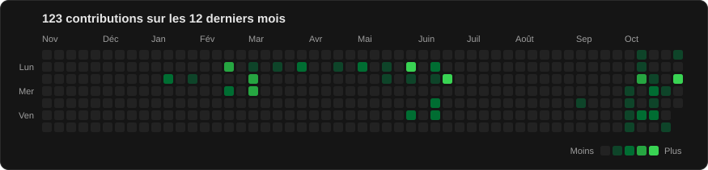

  

## À propos

-  Étudiant en **BUT Informatique (3ᵉ année)** à l'IUT Nice Côte d'Azur, Sophia Antipolis
-  En **alternance chez Thales DMS**
-  Me contacter : **Thomasbanderas06@gmail.com**

## Compétences

**Langages**

**Frameworks & bibliothèques**

**Bases de données**

**DevOps & systèmes**

**Outils**

## Activité

  

