<div align="center">



<a href="#stat"><code>[ STAT ]</code></a>&nbsp;
<a href="#inv"><code>[ INV ]</code></a>&nbsp;
<a href="#data"><code>[ DATA ]</code></a>&nbsp;
<a href="#map"><code>[ MAP ]</code></a>&nbsp;
<a href="#radio"><code>[ RADIO ]</code></a>

<br/><br/>

<a href="https://tiretinium.github.io/Tiretinium/"></a>

</div>

<br/>

<a name="stat"></a>


```text
> HABITANT ....... Tiretinium
> FORMATION ...... BUT Informatique (3e année) — IUT Nice Côte d'Azur, Sophia Antipolis
> AFFECTATION .... Alternant chez Thales DMS
> CONTACT ........ Thomasbanderas06@gmail.com
```


<br/>

<a name="inv"></a>



<details>
<summary><b>Ouvrir le sac</b> : tout l'inventaire</summary>

<br/>

**ARMES** — langages


**ÉQUIPEMENT** — frameworks & bibliothèques


**ATELIER** — bases de données, DevOps & systèmes


**BRIC-À-BRAC** — outils


</details>

<br/>

<a name="data"></a>




<div align="center">

<a href="https://github.com/Scubatana/scubanion"><code>▶ HOLOTAPE 01 · Scubanion</code></a>&nbsp;
<a href="https://github.com/ENIV-ENT/ENIV"><code>▶ HOLOTAPE 02 · ENIV</code></a>&nbsp;
<a href="https://github.com/Tiretinium/Tiretinium"><code>▶ HOLOTAPE 03 · Tiretinium</code></a>

</div>




<div align="center">
  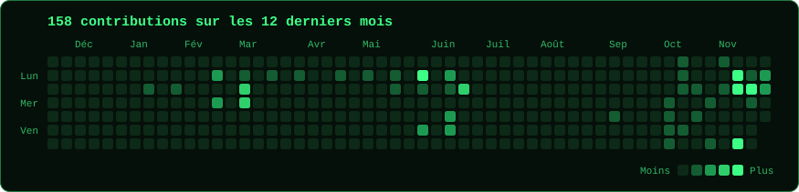
</div>

<div align="center">


</div>

<br/>

<a name="map"></a>



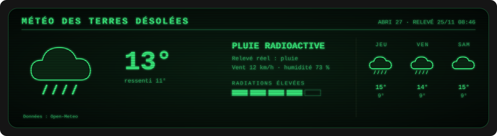

<br/>

<a name="radio"></a>




<div align="center">

<a href="mailto:Thomasbanderas06@gmail.com"></a>
<a href="https://discord.gg/Ge7AShwQ"></a>
<a href="https://tiktok.com/@tiretnium2703"></a>


<br/><br/>

<sub><code>FIN DE TRANSMISSION · ABRI 27</code></sub>

</div>
